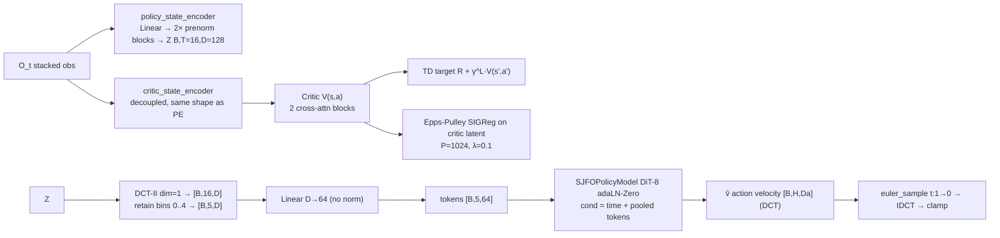

# Architecture — Spectral Joint Flow Policy Optimization (SJFPO, MuJoCo-only)

## Data Shapes (`T=16 H=16 n=8 K=5 D=128 spectral_dim=64`)

```
Observation (per step):  flat Box [obs_dim] (env-dependent; Hopper-v5: 11)
State window:            stacked frames [B,T,obs_dim] via deque (T=16)
Action chunk:            [B,H,act_dim] predicted (H=16), first n=8 executed open-loop
```

## Flow (SJFPO path — the only path)



Baseline path: `baselines.py` trains skrl 2.1.0 PPO/SAC on the same
frame-stacked env through the shared `baseline_train_loop`
(eval → 3-col CSV → checkpoint → wandb). No spectral/flow code involved.

## Key Contracts (break silently if flipped)

- **t-convention:** `x_t = t·ε + (1−t)·a`, `t=1` noise, `t=0` data. Sampling
  integrates **descending** `x ← x − δ·v̂` 1→0 (`fpo_core.euler_sample`,
  64 train / 16 eval steps). `trainer.py` samples `τ~U[0.005,0.995]`.
- **Spectral order:** DCT-II over time (dim=1), keep `K=5` low bins, then
  `Linear(D→64)` with no normalization. Tests assert
  invariance `B=1` vs `B=32`. (rFFT is reserved for observation.image.)
- **Decoupled encoders:** ASPO grads land on `policy_state_encoder`,
  value-TD + SigReg grads on `critic_state_encoder`; GAE values come from
  the critic encoder, spectral tokens from the policy encoder.
- **Inference:** deterministic zero-sampling eval (`eps=0`), single
  `clamp(-1,1)` after IDCT in `runner.decode_chunk_actions`.
- **Precision:** fp32 everywhere. No `autocast`/`half`/`bfloat16`/`torch.compile`.

## Why These Choices

- `K=5` low-frequency DCT tokens condition the flow on
  temporal structure of `Z`, not its DC offset.
- Epps-Pulley SIGReg single-home (`sigreg_loss`, P=1024, λ=0.1) — no Barlow/VICReg twins.
