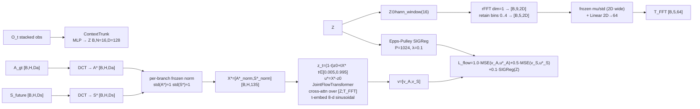

# Architecture — Spectral Joint Flow Matching (MuJoCo-only)

## Data Shapes (`N=16 H=8 K=5 D=128 Dk=64`)

```
Observation (per step):  flat Box [obs_dim] (env-dependent; Hopper-v5: 11)
Context window:          stacked frames [B,N,obs_dim] via FrameStackWrapper (N=16)
Action chunk:            [B,H,act_dim] (H=8)
```

## Flow (MFPO path)



Baseline path: `baselines.py` trains skrl 2.1.0 PPO/SAC on the same
frame-stacked env through the shared `baseline_train_loop`
(eval → 3-col CSV → checkpoint → wandb). No spectral/flow code involved.

## Key Contracts (break silently if flipped)

- **t-convention:** `z_t=(1-t)z0+tX*`, `t=0` noise, `t=1` data. MFPO inference
  integrates **ascending** `z←z+Δv` 0→1 (`inference.euler_integrate_joint`,
  16 train / 8 eval steps); legacy `fpo_core.euler_sample` descends 1→0.
  `trainer.py` samples `t~U[0.005,0.995]`.
- **Spectral order:** `Z⊙hann` **before** rFFT, then `cat(real,imag)` (so frozen
  stats are 2×D wide), then frozen norm, then `Linear(2D→64)`. Tests assert
  invariance `B=1` vs `B=32`.
- **Joint targets:** `A*` and `S*` normalized **independently** —
  `std(A*_norm)≈1` and `std(S*_norm)≈1` (tol 0.15). Denormalize→IDCT in
  `inference.py` inverts within `atol 1e-6`.
- **Inference:** `euler_integrate_joint` deterministic (no stochastic z0),
  gripper dims clipped to discrete `{0,1}`.
- **Precision:** fp32 everywhere. No `autocast`/`half`/`bfloat16`/`torch.compile`.

## Why These Choices

- Joint `[A*,S*]` lets the flow transformer learn action+future-state
  coherence; `S_hat` is auxiliary (decoded then discarded, never executed).
- Per-branch frozen norms prevent `λ_A/λ_S` being dominated by raw DCT scales.
- `K=5` low-frequency spectral tokens + Hann window condition the flow on
  temporal structure of `Z`, not its DC offset.
- Epps-Pulley SIGReg single-home (`sigreg_losses`, P=1024, λ=0.1) — no Barlow/VICReg twins.
