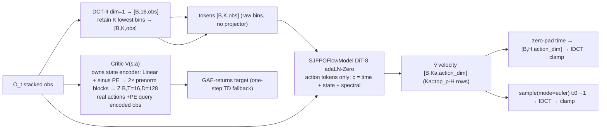

# Architecture — Spectral Joint Flow Policy Optimization (SJFPO, MuJoCo-only)

## Data Shapes (`T=16 H=16 K=5 D=128`, `K=round(top_p*T)`)

```
Observation (per step):  flat Box [obs_dim] (env-dependent; Hopper-v5: 11)
State window:            stacked frames [B,T,obs_dim] via deque (T=16)
Action chunk:            [B,H,action_dim] predicted (H=16); training executes all 16
                       open-loop, eval executes the ratio*H prefix (default 8)
```

## Flow (SJFPO path — the only path)



Baseline path: `baselines.py` trains skrl 2.1.0 PPO/SAC on the same
frame-stacked env through the shared `baseline_train_loop`
(eval → 3-col CSV → checkpoint → wandb). No spectral/flow code involved.

## Key Contracts (break silently if flipped)

- **t-convention:** `x_t = (1−t)·ε + t·a`, `t=0` noise, `t=1` data. Sampling
  integrates **ascending** `x ← x + δ·v̂` 0→1 (`fpo_core.sample`,
  64 train / 16 eval steps). `modeling_sjfpo.py` samples `τ~U[0.005,0.995]`.
- **Spectral order:** DCT-II over time (dim=1), keep the `K` lowest
  low-frequency bins (`K=max(1, round(top_p*T))`, default `0.3*16→5`), then
  with no normalization and no projector (last dim stays `obs_dim`). Tests assert
  invariance `B=1` vs `B=32`. (rFFT is reserved for observation.image.)
- **One encoder per model:** spectral tokens come straight from the raw obs window
  (no standalone policy state encoder — it lives inside `SJFPOFlowModel`);
  `Critic` owns its critic state encoder, carrying value grads.
  GAE values come from the Critic.
- **Inference:** deterministic zero-sampling eval (`eps=0`), single
  `clamp(-1,1)` after IDCT in `runner.decode_chunk_actions`.
- **Precision:** fp32 storage/buffers; bf16 autocast matmuls on CUDA; `torch.compile` on by default (`SJFPO_COMPILE=0` off).

## Why These Choices

- Top-`p` low-frequency DCT tokens condition the flow on
  temporal structure of `Z`, not its DC offset.
